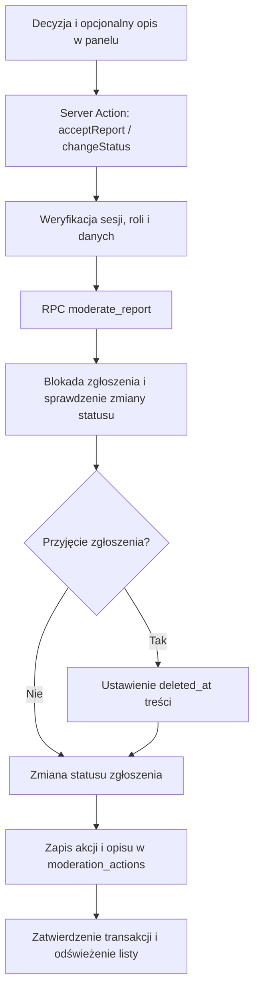

<div align="center">
  

  <h1>uniCheat</h1>

  <p>
    Platforma edukacyjna tworzona dla studentów<br />
    Zachodniopomorskiego Uniwersytetu Technologicznego w Szczecinie.
  </p>

  <p>
    <strong>Materiały • profile studentów • wykładowcy • moderacja • społeczność</strong>
  </p>
</div>

---
## SZYBKI LINK DLA REKUTERA
https://uni-cheat-smart-data-base-for-stude.vercel.app

## O projekcie

**uniCheat** porządkuje akademicką wiedzę w jednym miejscu. Użytkownik może utworzyć konto, skonfigurować swój wydział i kierunek, przechodzić przez semestry oraz przedmioty, a następnie przeglądać i udostępniać materiały innym studentom.

Projekt rozwijany jest jako aplikacja full-stack w Next.js. Warstwa uwierzytelniania, baza danych oraz pliki korzystają z Supabase, natomiast limity operacji obsługuje Upstash Redis.

### konto testowe

email: seed_student1@example.invalid
password: zaq1@WSX

email: seed_student2@example.invalid
password: zaq1@WSX

email: seed_student3@example.invalid
password: zaq1@WSX


### Konto i bezpieczeństwo

- rejestracja i logowanie przez Supabase Auth,
- potwierdzanie adresu e-mail przez callback PKCE/OTP,
- sesja SSR przechowywana w ciasteczkach i odświeżana przez Next.js Proxy,
- Cloudflare Turnstile w formularzach uwierzytelniania,
- walidacja formularzy przy użyciu Zod,
- ograniczanie liczby prób logowania i rejestracji przez Upstash Redis.

### Profil studenta

- dane osobowe i opis użytkownika,
- zainteresowania oraz odnośniki do GitHub i LinkedIn,
- wybór uczelni, wydziału, kierunku i semestru,
- publiczny lub prywatny profil,
- responsywny panel ustawień.

### Materiały edukacyjne

- ścieżka: **wydział → kierunek → semestr → przedmiot**,
- osobne kanały dla wykładów, laboratoriów i ćwiczeń,
- przesyłanie plików do Supabase Storage,
- lista materiałów z podglądem i pobieraniem przez czasowe signed URLs,
- limit przesyłania plików,
- zgłaszanie nieodpowiednich lub uszkodzonych materiałów,
- automatyczne dopasowanie katalogu materiałów do profilu studenta.

### Pozostałe moduły

- katalog wykładowców z wyszukiwaniem i profilami,
- komentarze i oceny wykładowców, edycja własnych opinii oraz zgłaszanie komentarzy,
- widok społeczności studenckiej,
- sekcja FAQ,
- animowany landing page prezentujący platformę.

## Stan implementacji

| Obszar | Źródło danych | Stan |
| --- | --- | --- |
| Uwierzytelnianie | Supabase Auth | Podłączone |
| Profil użytkownika | Supabase Database | Podłączone |
| Wydziały, kierunki, semestry i przedmioty | Supabase Database | Podłączone |
| Materiały i zgłoszenia | Supabase Database + Storage | Podłączone |
| Limity operacji | Upstash Redis | Podłączone |
| Katalog wykładowców, opinie i oceny | Supabase Database | Podłączone |
| Panel moderatora i historia decyzji | Supabase Database + RPC `moderate_report` | Podłączone |
| Społeczność | Dane lokalne w komponencie | Wersja demonstracyjna |

## Panel moderatora

Panel jest dostępny pod `/moderator` dla zalogowanych użytkowników z rolą `moderator` lub `admin` w `profiles.role`. Osoba niezalogowana jest przekierowywana do `/login`, a użytkownik bez odpowiedniej roli — do `/profile`. Uprawnienia są ponownie sprawdzane w Server Actions i w funkcji bazy danych.

Panel łączy zgłoszenia materiałów (`material_reports`) i komentarzy wykładowców (`reported_lecturer_comments`). Pokazuje powód zgłoszenia, autora zgłoszenia i podgląd treści. Udostępnia wyszukiwanie, filtry rodzaju i statusu oraz paginację kursorową po 10 zgłoszeń. Oczekujące zgłoszenia są wyświetlane najpierw; filtry i liczniki dotyczą bieżącej strony.

### Decyzje i opis moderatora

| Przycisk | Status zgłoszenia | Wpływ na zgłoszoną treść |
| --- | --- | --- |
| Przyjmij zgłoszenie | `pending` → `resolved` | Ustawia `deleted_at` w `materials` lub `lecturer_comments` |
| Odrzuć zgłoszenie | `pending` → `rejected` | Pozostawia treść bez zmian |
| Przywróć do oczekujących | `resolved` / `rejected` → `pending` | Nie przywraca usuniętej treści |

Przed każdą decyzją można uzupełnić pole **Opis decyzji**: opcjonalne uzasadnienie do 1000 znaków, z licznikiem długości. Opis jest zapisywany w `moderation_actions.reason` razem z akcją. To osobne pole od powodu zgłoszenia podanego przez zgłaszającego. Pusty opis jest pomijany, a skrajne spacje są usuwane.

Szkice opisu są przypisane do poszczególnych zgłoszeń w aktualnym widoku panelu. Pozostają po błędzie zapisu, a po sukcesie opis wykonanej decyzji jest czyszczony. Podczas zapisu pole i przyciski decyzji są zablokowane. Panel pokazuje wynik operacji i pobiera świeżą pierwszą stronę, odrzucając wcześniejsze kursory — zmiana statusu wpływa na kolejność zgłoszeń.

### Zapis w bazie i kontrola dostępu



Funkcja `public.moderate_report` wykonuje zmianę statusu, ewentualne oznaczenie treści jako usuniętej i zapis historii w jednej transakcji. Błąd dowolnego etapu wycofuje wszystkie zmiany tej operacji. `FOR UPDATE` blokuje wiersz zgłoszenia na czas decyzji; ponowienie tego samego statusu jest odrzucane. Przejście bezpośrednio między `resolved` i `rejected` wymaga wcześniejszego przywrócenia `pending`.

Historia jest zapisywana w istniejącej tabeli **`moderation_actions`**:

| Pole | Zapisywana wartość |
| --- | --- |
| `moderator_id` | ID zalogowanego użytkownika pobrane przez `auth.uid()` |
| `report_id` | ID rozpatrywanego zgłoszenia |
| `report_type` | `material_reports` lub `reported_lecturer_comments` |
| `action` | Nowy status: `resolved`, `rejected` lub `pending` |
| `reason` | Opcjonalny opis decyzji moderatora |
| `created_at` | Data utworzenia wpisu, zgodnie z domyślną wartością tabeli |

Klient nie przekazuje `moderator_id`. Dodatkowa restrykcyjna polityka RLS wymaga, aby ID moderatora we wpisie było zgodne z `auth.uid()`. Funkcja działa jako `SECURITY INVOKER`, z uprawnieniami wywołującego i obowiązującymi zasadami RLS.

Usuwanie treści jest logiczne: rekord materiału lub komentarza pozostaje w bazie, a istniejąca data `deleted_at` nie jest nadpisywana. Odczyty materiałów, komentarzy i średniej ocen pomijają usunięte wpisy; moderator nadal może zobaczyć treść w podglądzie zgłoszenia. Operacja nie usuwa fizycznie pliku ze Storage i nie unieważnia już wystawionych signed URLs.

## Stack technologiczny

| Warstwa | Technologie |
| --- | --- |
| Framework | Next.js 16, App Router, React 19 |
| Język | TypeScript |
| Style | Tailwind CSS 4, CSS Modules, shadcn, Base UI |
| Backend | Server Components, Server Actions, Route Handlers |
| Uwierzytelnianie | Supabase Auth, `@supabase/ssr` |
| Dane | PostgreSQL przez Supabase Data API |
| Pliki | Supabase Storage |
| Migracje | Supabase CLI, PostgreSQL SQL |
| Walidacja | Zod |
| Rate limiting | Upstash Redis, `@upstash/ratelimit` |
| CAPTCHA | Cloudflare Turnstile |
| Animacje | Framer Motion, Lenis, Lottie |
| Ikony | Lucide React |

## Wymagania

Przed uruchomieniem przygotuj:

- Node.js 22 lub nowszy,
- npm,
- projekt Supabase,
- Docker Desktop lub inny runtime zgodny z Dockerem — tylko dla lokalnego Supabase,
- bazę Upstash Redis,
- widget Cloudflare Turnstile.

## Uruchomienie lokalne

1. Sklonuj repozytorium i przejdź do jego katalogu:

   ```bash
   git clone <adres-repozytorium>
   cd uniCheat
   ```

2. Zainstaluj zależności:

   ```bash
   npm install
   ```

3. Utwórz plik `.env.local`:

   ```env
   # Supabase
   NEXT_PUBLIC_SUPABASE_URL=https://twoj-projekt.supabase.co
   NEXT_PUBLIC_SUPABASE_PUBLISHABLE_KEY=twoj_publishable_key

   # Adres aplikacji używany w linkach potwierdzających e-mail
   NEXT_PUBLIC_SITE_URL=http://localhost:3000

   # Cloudflare Turnstile
   NEXT_PUBLIC_TURNSTILE_SITE_KEY=twoj_site_key

   # Upstash Redis — nazwy wymagane przez Redis.fromEnv()
   UPSTASH_REDIS_REST_URL=https://twoja-baza.upstash.io
   UPSTASH_REDIS_REST_TOKEN=twoj_token

   # Opcjonalne; domyślna wartość to "materials"
   SUPABASE_MATERIALS_BUCKET=materials
   ```

4. Uruchom środowisko developerskie:

   ```bash
   npm run dev
   ```

5. Otwórz [http://localhost:3000](http://localhost:3000).

## Konfiguracja Supabase

Repozytorium zawiera konfigurację Supabase CLI, migracje oraz typy TypeScript:

- `supabase/config.toml` — konfiguracja lokalnych usług Supabase,
- `supabase/migrations/20260927232148_remote_schema.sql` — początkowy schemat bazy,
- `supabase/migrations/20261123201211_moderator_report_actions.sql` — RPC moderacji i uzupełnienie polityk RLS,
- `lib/database.types.ts` — typy używane przez aplikację.

Początkowa migracja tworzy:

- `profiles`,
- `faculties`,
- `courses`,
- `semesters`,
- `subjects`,
- `subject_channels`,
- `materials`,
- `material_reports`.

Zawiera również enumy kanałów i motywów, klucze obce, ograniczenia integralności, triggery profilu, RLS oraz polityki dostępu do tabel i plików.

**Wymagania migracji moderacji:** zakłada ona istniejący rozszerzony schemat: tabele `lecturers`, `lecturer_comments`, `reported_lecturer_comments`, `moderation_actions`, kolumny `materials.deleted_at` i `lecturer_comments.deleted_at`, `profiles.role` oraz enum `reportStatus_type`. Odczyt panelu wymaga również funkcji `get_material_reports_page` i `get_comment_reports_page`. Te wcześniejsze rozszerzenia nie są w całości odtworzone w początkowej migracji repozytorium. Sam zestaw obecnych migracji nie wystarcza więc do uruchomienia aktualnej aplikacji na pustej bazie — przed zastosowaniem migracji moderacji trzeba uzupełnić schemat o te definicje.

### Lokalna baza danych

Uruchom usługi Supabase w kontenerach:

```bash
npx supabase start
```

Supabase stosuje migracje podczas inicjalizacji lokalnej bazy. Przed inicjalizacją lub resetem uzupełnij brakujące migracje rozszerzonego schematu opisane powyżej. Polecenie resetu usuwa lokalne dane i odtwarza bazę z plików migracji:

```bash
npx supabase db reset --local --no-seed
```

Flaga `--no-seed` jest potrzebna, dopóki projekt nie zawiera pliku `supabase/seed.sql`.

### Zdalny projekt Supabase

Po uwierzytelnieniu Supabase CLI połącz repozytorium ze swoim projektem:

```bash
npx supabase link --project-ref <project-ref>
```

Najpierw sprawdź plan migracji, a następnie zastosuj go do podłączonej bazy:

```bash
npx supabase db push --linked --dry-run
npx supabase db push --linked
npx supabase migration list --linked
```

`db push` zmienia schemat zdalnej bazy. Przed wykonaniem polecenia na środowisku produkcyjnym wykonaj kopię zapasową i przejrzyj wygenerowany plan.

### Dodatkowa konfiguracja

Po zastosowaniu migracji należy dodatkowo:

1. Utworzyć prywatny bucket Storage o nazwie `materials`.
   Migracja dodaje polityki dostępu do `storage.objects`, ale nie tworzy samego bucketu.
2. Upewnić się, że tabele schematu `public` są dostępne przez Data API. Migracja zawiera wymagane granty oraz włącza RLS.
3. Skonfigurować callback uwierzytelniania:

   ```text
   http://localhost:3000/auth/confirm
   ```

4. W ustawieniach Supabase Auth skonfigurować Cloudflare Turnstile przy użyciu odpowiadającego mu secret key.

Materiały są udostępniane przez signed URLs ważne przez godzinę, dlatego bucket nie musi być publiczny.

## Skrypty

| Polecenie | Działanie |
| --- | --- |
| `npm run dev` | Uruchamia serwer developerski z hot reloadem |
| `npm run build` | Tworzy zoptymalizowany build produkcyjny i sprawdza typy |
| `npm run start` | Uruchamia wcześniej zbudowaną wersję produkcyjną |
| `npm run lint` | Uruchamia ESLint dla całego projektu |
| `npm run seed` | Dodaje demonstracyjne dane akademickie, materiały, opinie i zgłoszenia do istniejącej bazy |
| `npm run seed:check` | Uruchamia testy generatora danych seeda |

Instrukcja i wymagania seeda: [supabase/SEED.md](supabase/SEED.md). Seed nie tworzy kont Auth ani nie nadaje ról moderatora.

### Test transakcji moderacji

Na lokalnej bazie z aktualnym schematem i danymi testowymi:

```bash
npx supabase db query --local --file scripts/moderator-actions.test.sql
```

Test wymaga profilu `admin`, profilu `user` oraz zgłoszenia materiału i komentarza. Sprawdza role moderatora i administratora, przyjęcie obu rodzajów zgłoszeń, zapis opisu i tożsamości w historii, blokadę cudzego `moderator_id`, odrzucenie i ponowne otwarcie, powtórzone decyzje oraz wycofanie transakcji przy błędzie zapisu historii. Zmiany testowe są automatycznie wycofywane.

Przed wysłaniem zmian warto wykonać:

```bash
npm run lint
npm run build
```

## Główne trasy

| Trasa | Opis |
| --- | --- |
| `/` | Landing page projektu |
| `/login` | Logowanie |
| `/register` | Rejestracja |
| `/profile` | Ustawienia profilu zalogowanego użytkownika |
| `/materials` | Wejście do materiałów i konfiguracja ścieżki studiów |
| `/materials/[faculty]/[course]` | Lista semestrów kierunku |
| `/materials/[faculty]/[course]/[semester]` | Przedmioty wybranego semestru |
| `/materials/[faculty]/[course]/[semester]/[subject]` | Materiały konkretnego przedmiotu |
| `/lecturers` | Katalog wykładowców |
| `/lecturers/[slug]` | Profil wykładowcy, komentarze i oceny |
| `/moderator` | Panel zgłoszeń dla administratorów i moderatorów |
| `/community` | Widok społeczności |
| `/faq` | Najczęściej zadawane pytania |

## Struktura projektu

```text
uniCheat/
├── app/                    # Trasy App Routera, strony i Server Actions
│   ├── auth/               # Logowanie, rejestracja i callback Auth
│   ├── materials/          # Nawigacja akademicka i materiały
│   ├── profile/            # Profil oraz ustawienia użytkownika
│   ├── lecturers/          # Katalog, profile, opinie i zgłoszenia komentarzy
│   ├── moderator/          # Panel zgłoszeń, decyzje i opis moderatora
│   ├── community/          # Moduł społeczności
│   └── faq/                # FAQ
├── components/             # Komponenty współdzielone, layout i UI
├── data/                   # Lokalne dane demonstracyjne
├── lib/
│   ├── queries/            # Zapytania do Supabase
│   ├── redis/              # Klient i limity Upstash
│   └── supabase/           # Klienci browser/server oraz obsługa sesji
├── public/                 # Ikony i animacje Lottie
├── scripts/                # Seed i test transakcji moderacji
├── supabase/
│   ├── migrations/         # Wersjonowany schemat PostgreSQL, RLS i polityki
│   └── config.toml         # Lokalne środowisko Supabase CLI
├── proxy.ts                # Odświeżanie sesji i ochrona tras
└── lib/database.types.ts   # Typy wygenerowane ze schematu Supabase
```

## Architektura uwierzytelniania

```text
Przeglądarka
    │
    ▼
Next.js Proxy ── weryfikacja claims i odświeżanie cookies
    │
    ▼
Server Components / Server Actions
    │
    ├── Supabase Auth
    ├── Supabase Database
    ├── Supabase Storage
    └── Upstash Redis
```

Proxy chroni trasę `/profile` i przekierowuje zalogowanych użytkowników z `/login` oraz `/register` do ich profilu. Operacje modyfikujące dane ponownie sprawdzają użytkownika po stronie serwera — dostęp nie opiera się wyłącznie na przekierowaniu.

## Zasady pracy z projektem

- Nie zapisuj sekretów ani plików `.env*` w repozytorium.
- Każdą zmianę schematu zapisuj jako nową migrację w `supabase/migrations`.
- Po zmianie schematu Supabase zaktualizuj `lib/database.types.ts`.
- Wszystkie nowe tabele dostępne przez Data API powinny mieć włączone RLS.
- Waliduj dane zarówno w interfejsie, jak i w Server Actions.
- Dla plików i operacji użytkownika zachowuj limity oraz kontrolę właściciela zasobu.

## Dalszy rozwój

Najbliższe naturalne kierunki rozwoju projektu:

- przeniesienie forum społeczności do bazy danych,
- widok historii decyzji moderatorów i przywracanie usuniętych treści,
- trwała obsługa zdjęć profilowych,
- testy jednostkowe, integracyjne i end-to-end,
- uzupełnienie migracji rozszerzonego schematu i ich automatyczna weryfikacja w CI.

---

<div align="center">
  Tworzone z myślą o studentach ZUT.
</div>
